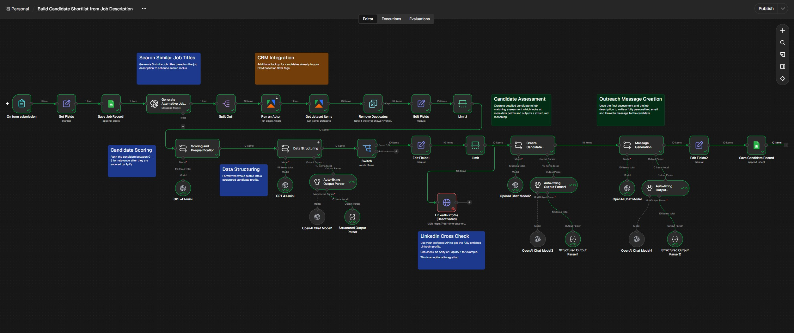
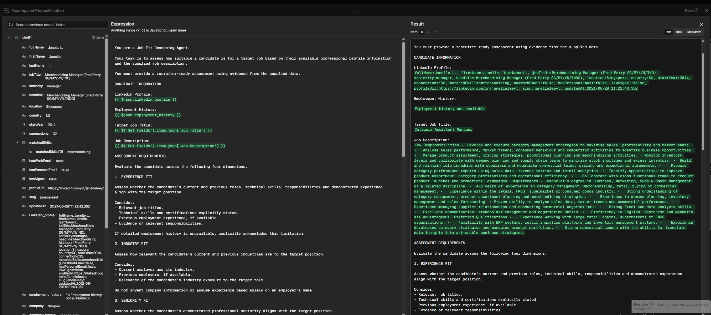
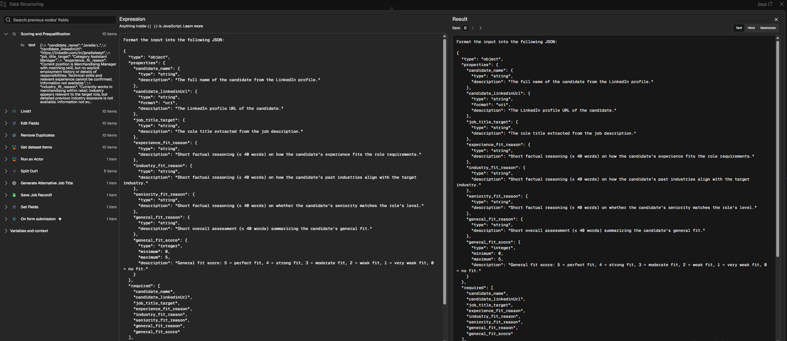

# AI-Powered Recruitment Automation

An end-to-end recruitment automation workflow built using **n8n, OpenAI, Apify and Google Sheets**. The system automates candidate sourcing, prequalification, AI-driven candidate assessment and personalised recruitment outreach.

## 1. Project Overview

Recruitment involves repetitive activities such as searching for candidates, reviewing LinkedIn profiles, comparing qualifications against job descriptions and preparing outreach messages.

This project aims to streamline these activities through an AI-powered workflow that transforms a job description into a structured candidate shortlist.

The workflow accepts job requirements, searches for relevant candidate profiles, evaluates their suitability using AI and stores the resulting assessments in Google Sheets for recruiters to review and filter.

## 2. Key Features

- **Job Processing:** Captures job title, description, location and target companies through a form.
- **Job Title Expansion:** Uses AI to generate alternative job titles to broaden candidate search coverage.
- **Automated Candidate Sourcing:** Uses Apify to retrieve candidate profiles based on job titles, skills and geographical criteria.
- **Candidate Deduplication:** Removes duplicate candidate records.
- **Candidate Prequalification:** Evaluates candidate profiles against initial job requirements.
- **AI Candidate Assessment:** Generates structured assessments covering skills, experience, industry alignment, seniority and education.
- **Recruitment Outreach:** Generates personalised email and LinkedIn messages based on candidate assessments.
- **Centralised Database:** Stores job and candidate records in Google Sheets for filtering and recruitment tracking.

## 3. Technology Stack

| Technology | Purpose |
|---|---|
| n8n | Workflow orchestration and automation |
| OpenAI | Job title generation, candidate evaluation and outreach generation |
| Apify | Candidate profile sourcing and data retrieval |
| Google Sheets | Job and candidate database |
| JavaScript | Data transformation and workflow expressions |

## 4. Workflow Architecture

### Stage 1: Job Submission and Processing

The recruiter submits a job through an n8n form containing:
- Job title
- Job description
- Location
- Target companies (Optional)

The workflow generates a unique Job ID and saves the job record in Google Sheets.

### Stage 2: Job Title Expansion and Candidate Sourcing

An AI model generates alternative job titles based on the original job description.

These titles are passed to Apify to search for potential candidates using relevant skills and geographical filters.

Candidate results are retrieved from the Apify dataset.

### Stage 3: Candidate Prequalification

The retrieved profiles go through several processing steps:

1. Remove duplicate candidate records.
2. Standardise candidate information.
3. Limit the number of candidates processed.
4. Evaluate candidates against the job requirements.
5. Assign an initial fit assessment.

### Stage 4: AI Candidate Assessment

An AI model evaluates each candidate against multiple dimensions:

- Title alignment
- Skills alignment
- Industry experience
- Seniority alignment
- Company type alignment
- Experience alignment
- Education alignment
- Potential red flags
- Positive signals

The model produces a structured JSON assessment containing an overall fit rating, executive summary, reasoning and recruitment recommendation.

## Candidate Scoring 

### Stage 5: Recruitment Outreach Generation

Based on the candidate assessment and original job description, another AI model generates:

- Personalised email subject
- Personalised email body
- LinkedIn outreach message

The messages are prepared for recruiter review before being sent.

### Stage 6: Database Storage

The final candidate records are appended to Google Sheets.

Each record contains candidate identification, job association, assessment results, recommendations, outreach messages and recruitment status.

This allows recruiters to filter candidates by job, fit score, industry alignment and recruitment status.

## 5. Database Structure

The Google Sheets database maintains two types of records:

**Job Records**
- Job ID
- Job title
- Job description
- Location
- Creation timestamp

**Candidate Records**
- Candidate ID
- Job ID
- Candidate name and contact information
- LinkedIn URL
- Summary fit score
- Executive summary
- Skills and experience alignment
- Education alignment
- Potential red flags
- Positive signals
- Final recommendation
- Next-stage suggestion
- Email and LinkedIn outreach messages
- Recruitment status
- Creation timestamp

The Job ID links candidates back to the vacancy they were sourced for.

## Data Structuring 

## 6. Project Setup

### Prerequisites

- An n8n instance
- OpenAI API credentials
- Apify account and API access
- Google account with Google Sheets access

### Importing the Workflow

1. Download the workflow JSON from this repository.
2. Open your n8n instance.
3. Import the workflow JSON.
4. Configure your own OpenAI credentials.
5. Configure your Apify credentials and actor.
6. Connect your Google Sheets account.
7. Update the spreadsheet and worksheet references.
8. Review the workflow parameters and execute a test using sample data.

**Important:** API credentials and private spreadsheet information are not included in this repository.

## 7. Future Improvements

Potential enhancements include:

- More advanced candidate ranking and weighted scoring.
- CRM integration for existing candidate lookups.
- Automated LinkedIn profile enrichment.
- Email integration for sending approved outreach messages.
- Candidate status tracking and recruitment pipeline dashboards.
- Improved geographical filtering and candidate search accuracy.
- Duplicate detection across historical recruitment records.
- Human-in-the-loop approval before outreach.

## 8. Disclaimer

This project is a recruitment automation prototype intended to assist recruiters with candidate sourcing and preliminary assessment.

AI-generated assessments are decision-support outputs and should not replace human evaluation. Candidate information and recommendations should be reviewed before making recruitment decisions.

---

**Project:** AI-Powered Recruitment Automation  
**Built with:** n8n | OpenAI | Apify | Google Sheets